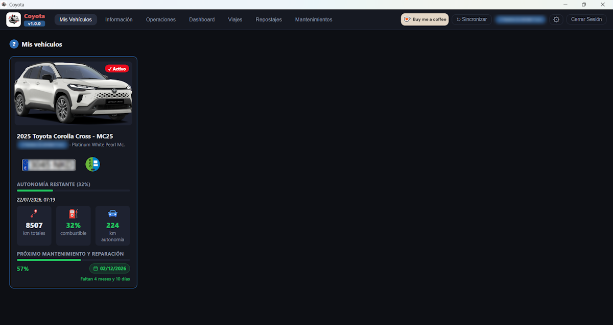

 

  

  

---

  

> [!TIP]
> Cuando usas **Coyota**, lo habitual es que sincronices manualmente los **Viajes** dentro de dicha sección, pero si echas en falta alguno, puedes forzar dicha sincronización acudiendo a la **Configuración**, y allí, situarte en el  apartado **Sincronización** para dentro de este apartado, pulsar el botón **Sinzronización completa**.
>
> **Coyota** buscará los viajes no descargados o que estén incompletos, y forzará la actualización de la información correctamente.

---

> [!IMPORTANT]
> **Aviso importante**
> `Aviso legal y exención de reponsabilidad`:
> 
> **Coyota Vehicle Manager** (aka **Coyota**) es una aplicación no oficial e independiente, sin ninguna afiliación, patrocinio, ni respaldo de Toyota Motor Corporation ni de ninguna de sus filiales.
> 
> El uso de Coyota implica la aceptación de que el autor no se hace responsable de ningún daño directo o indirecto, pérdida de datos, mal funcionamiento del vehículo, ni de cualquier otra consecuencia derivada del uso o mal uso de la misma.
> 
> El desarrollador de Coyota, queda exento de cualquier problema directo o indirecto derivado de su uso. La ejecución y uso de la aplicación, se realiza bajo la entera comprensión de los riestos -si los hubiera-, y la asunción de los mismos por parte del usuario.
> 
> Los datos del vehículo mostrados en Coyota, se obtienen directamente desde los servidores de Toyota mediante las credenciales personales que el usuario introduce, las cuales se almacenan de forma segura en el Keychain del sistema operativo.
> 
> Los datos que el usuario introduce, credenciales y cualquier otro que Coyota pudiera usar o gestionar, nunca se transmiten a terceros ni se usan para fines estadísticos, publicitarios o de cualquier otra índole. Toda la información recogida, por la aplicación, permanece almacenada localmente en el ordenador del usuario, y éste (el usuario) es el responsable de salvaguardar y gestionar dicha información de forma segura.
> 
> Coyota utiliza una API de la propia Toyota (`Toyota EU MyToyota ctpa-oneapi API`), y ésta queda fuera del alcance del desarrollador, por lo que en el caso de que ésta cambiara o Toyota dejara de dar el servicio, podría hacer que Coyota dejara de funcionar.
> 
> Al usar Coyota, el usuario de la misma admite que el autor de la aplicación, no posee obligación de ningún tipo de mejorar, actualizar, modificar o mantener Coyota a lo largo del tiempo, y no se le puede exigir responsabilidad alguna por su uso, matenimiento, soporte, pérdida de datos o cualquier otra circunstancia que ocasionara un perjuicio para el usuario.

## ¿Qué es Coyota Vehicle Manager?
> [!TIP]
> Es una aplicación multiplataforma para `Windows`, `Linux` y `macOS` (procesadores Apple Silicon únicamente), `en español`, y que permite gestionar tus vehículos Toyota y Lexus, y **pensada inicialmente para el mercado Europeo de España**.
>
> Coyota no usa ningún paquete de terceros ni intermediarios de ningún tipo para conectarse a la _API de Toyota_ ni gestionar su conectividad. Todo en Coyota está desarrollado desde cero con conexiones directas con Toyota.

> [!NOTE]
> Inicialmente el proyecto nació para dar soporte para `macOS Intel` también, pero la incompatibilidad de algunas funcionalidades a la hora de presentarlas en pantalla, hacía inviable esta vía, por lo que en la v0.6.1 se decidió eliminar esa posibilidad y sólo está disponible para **Windows**, **Linux** y **macOS Apple Silicon**.

Accede al  para conocer más sobre la aplicación y las diferentes secciones que encontraremos.

## `Notas de Releases`

---

-  **Dashboard** - Se ha creado una sección nueva llamada **Análisis de mi conducción**, para analizar la conducción del conductor con un vehículo. La pantalla **Dashboard** no sufre alteración, pero la nueva sección profundiza sobre los datos del _Panel_ o _Dashboard_, para mostrar información más precisa, detallada, y fácilmente visible con el fin de ayudar a interpretar dónde se debe o puede mejorar
-  **Análisis de mi conducción** - Se ha creado una sección _Mapa de comportamientos de conducción_ para mostrar un mapa de calor de los comportamientos a mejorar, los comportamientos positivos, o ambos comportamientos
-  **Análisis de mi conducción** - Dentro de la sección _Mapa de comportamientos de conducción_, haciendo zoom en el mapa y seleccionando una zona concreta que tiene comportamientos de conducción, mostrará un listado de viajes relacionados con ese punto del mapa en los que hay datos que pueden ser analizados con el propósito de ser más metódico cuando se circule por esa zona. Cabe destacar que no aparecerán eventos de un viaje individual, sino eventos en diferentes viajes que se han repetido en una zona del mapa aproximada
-  **Análisis de mi conducción** - Se ha creado una sección _Consumo, distancia y EV por mes_ para analizar por año seleccionado, en una vista rápida de cuadro de mando, el consumo medio l/100km, el % de conducción en EV, y la cantidad de kms realizados
-  **Análisis de mi conducción** - Se ha creado una sección _Repostajes por mes_ para analizar por año seleccionado, en una vista rápida de cuadro de mando, el gasto en €, la cantidad de litros repostados por mes, y el precio medio de la gasolina dentro de ese mes
-  **Notas** - Se ha completado el desarrollo completo de la búsqueda de información dentro de los documentos que forman parte de _Notas_
-  **Mapas** - El botón _Vista general_ que había en los mapas de _Repostajes_ y _Precios de carburantes_, y ahora el que aparece con la misma funcionalidad en <em>Análisis de mi conducción</em>, han sido renombrados de _Vista general_ a _Resituar mapa_
-  **Notas** - El buscador dentro de **Notas** no estaba funcionando porque la funcionalidad no estaba terminada aún. El mayor error estuvo en que con la urgencia de la publicación de la anterior versión de la aplicación, se dejó visible esa acción, que estaba pendiente de ser cerrada y probada, algo que ya ha podido ser completada en esta versión

## Enlaces que pueden ser de interés

### Aplicaciones móviles oficiales Toyota
- [Toyota - MyToyota App para Android](https://play.google.com/store/apps/details?id=com.toyota.oneapp.eu)
- [Toyota - Mytoyota App para iOS](https://apps.apple.com/es/app/mytoyota/id1617623127)

### Aplicaciones móviles de terceros
- [Spritmonitor - para Android](https://play.google.com/store/apps/details?id=de.spritmonitor.smapp_mp&hl=es)
- [Spritmonitor - para iOS](https://apps.apple.com/es/app/spritmonitor-consume-costos/id616137163)

### Documentación de Toyota
- [Toyota - TME Customer REST API Documentation (Europa)](https://consumer-api.toyota-europe.com/docs/?json#tme-customer-rest-api)

### Librerías y aplicaciones de terceros (obsoletas)
- [Pypi.org - mytoyota - Python Client for Toyota Connected Services (sin actualizarse desde febrero del año 2025)](https://pypi.org/project/mytoyota/#history)
- [GitHub - tojota (sin actualizar desde hace más de 2 años)](https://github.com/calmjm/tojota)

### Aplicaciones de terceros que actualmente se mantienen
- [GitHub - ha_toyota (Toyota Europa - usa pytoyoda)](https://github.com/pytoyoda/ha_toyota/)
- [GitHub - ha_toyota_na (Toyota Norteamérica - usa pytoyoda)](https://github.com/widewing/ha-toyota-na)
- [GitHub - pytoyoda (Toyota Europa)](https://github.com/pytoyoda/pytoyoda)

### Precio de carburantes en las gasolineras españolas
- [datos.gob.es](https://datos.gob.es/es/catalogo/e05068001-precio-de-carburantes-en-las-gasolineras-espanolas)
